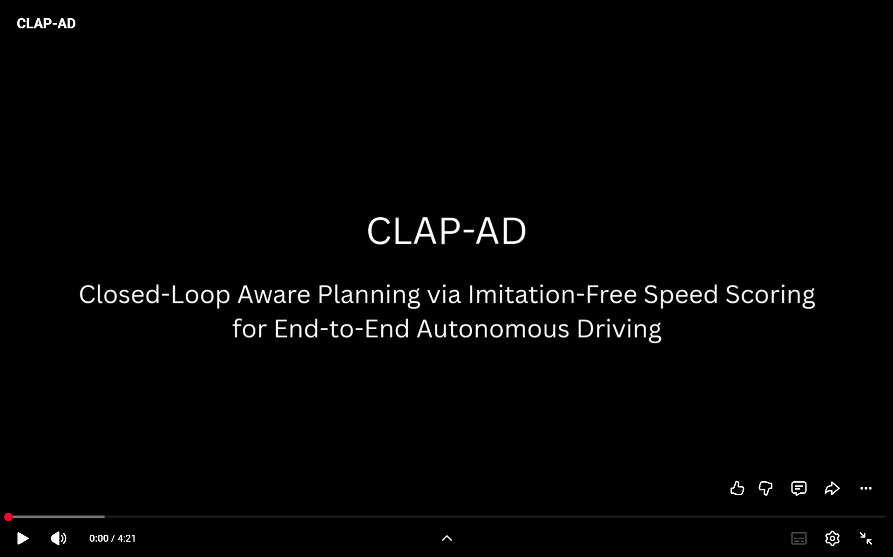

# CLAP-AD: Closed-Loop Aware Planning via Imitation-Free Speed Scoring for End-to-End Autonomous Driving

CLAP-AD introduces a novel paradigm in which the driving path is learned via imitation, while the speed is conditioned on the predicted path and optimized through multi-criteria **imitation-free** scoring. This scoring-based planner realizes a synergistic optimization of path and speed for improved closed-loop performance.

## Showcase

*Closed-loop showcase of CLAP-AD.*

## Publication

The work is in preparation for submission to **WACV 2027**.

## Code

The full code will be released upon acceptance.
